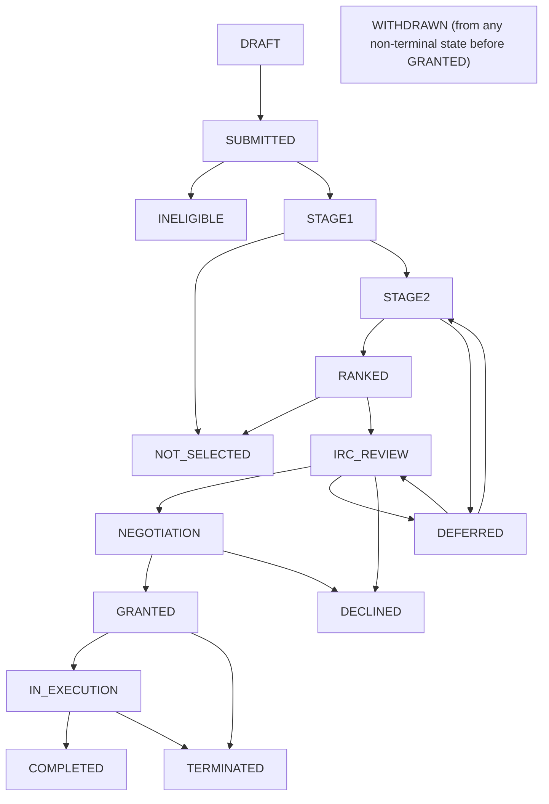

# Journey UI layer: handoff for the implementing agent

Status: accepted 2026-11-01 (Daniel Thompson-Yvetot), with ADR-015 accepted the same day.
Location: `SPEC/12-journey-ui.md`. Reading position: after `09-milestones.md`, before `10-open-questions.md`.
IDs confirmed on 2026-11-01: R-JV-01 to R-JV-12, I-92 to I-97, O-54 to O-60 and B-02. The spec ended at I-91, P-78 and O-53. This layer adds no policy parameter. I-92 to I-97 are also listed in `02-domain/invariants.md`, which ranks first.

Read `.claude/CLAUDE.md` and `docs/adr/` first. This document was reconciled against `CLAUDE.md` and ADR-001 to ADR-007. Where this file and those rules differ, they win.

Conflict order, from `CLAUDE.md`: `SPEC/02-domain/invariants.md`, then `SPEC/01-requirements/`, then `SPEC/02-domain/`, then `SPEC/03-architecture/`. If a conflict remains, stop and ask Daniel. Never resolve a conflict by weakening an invariant.

## 1. Purpose

Give every actor a consistent, engaging way to see where they are in the process, using one metaphor: **a voyage, with a logbook (diary) kept along the way**.

| Actor | Metaphor | Surface |
| --- | --- | --- |
| Applicant, team member, grantee ("voyager") | Traveller | Route map + Passage Diary |
| Programme manager, call drafter ("trip planner") | Route planner | Programme creator, presented as the Planning Studio |
| FSTP coordinator, committee, assigned reviewer, IRC | Border control, scouts, council | Work queues with a route-position view |
| Finance approver, payment releaser, contract signatory | Harbour office | Payment and contract queues |
| Auditor | Archivist | Read-only chronicle and audit views |
| Public | Passer-by | Public pages (static, no scripts) |

### Non-goals

- The layer is **presentation and projection only**. It adds no state to the proposal state machine, no new decision, and no new authority.
- It never changes the legal wording of contracts, notices, the Guide for Applicants, funder documents or emails (I-72).
- It does not make the metaphor mandatory. Plain grant language is the platform default. Voyage is an optional vocabulary pack a tenant can switch on (O-55).

## 2. Corrections to the earlier design discussion

These points were stated or implied in earlier conversation and are **wrong against the spec**. The spec wins.

| Earlier idea | Problem | Rule |
| --- | --- | --- |
| Flowchart topology editable by planners (toggle stages, YAML config) | The state machine is fixed, model-checked and frozen per call (I-12). The in-house stack has no YAML parser | Planners edit policy values and copy only. Topology is code. Definitions are JSON |
| `RANKED -> DEFERRED` on "budget exceeded" | No such transition. Budget is informational (R-EV-08) | Use the real transitions in section 5 |
| Stage 2 as an optional, toggleable loop | STAGE2 always exists. P-07 sets its window length | Show the window length only |
| Mermaid in the product | Third-party script on a UI that is in-house and, on public pages, script-free (R-PB-04) | Server-rendered SVG. Mermaid only in docs |
| Google or third-party fonts (Inter, Instrument Serif) | Fonts are self-hosted, no third-party hosts (`white-labelling.md`) | Tenant typography tokens |
| Dispatch console naming reviewers disqualified by affiliation | Judging roles get boolean conflict answers only (R-CF-03). Refusals name the rule, never an account | Show "conflict: yes, reassign" with no identity |
| Live radar showing proposal titles to all staff | Read access follows P-10. The coordinator declares conflicts before the knock-out read (R-CF-02) | Counts and pseudonymous ids until access exists |
| Milestone approval automatically triggers payment | Acceptance and release are different persons and steps (I-05, SoD-04) | Show the real payment request states |
| Submission "cryptographic hash seal" on the ticket | Not in the spec | Receipt shows ledger sequence and time only (R-JV-04) |
| Call cards with an "acceptance rate / difficulty rating" | Not in the spec, may leak evaluation data | Drop. Show P-04, deadline, scope, Guide link |
| Mermaid or any npm package run in CI to render diagrams | Dependency policy: in-house by default, only allowlisted tools (ADR-003) | The SVG renderer is in-house. Mermaid text stays in documentation only |
| Python for the drift test, fixtures or snapshot tooling | `CLAUDE.md`: no Python anywhere | Write all tooling in Rust or TypeScript |
| Amounts as "integer minor units" in the journey API | ADR-006: amounts are canonical decimal strings, never JSON numbers, never floats | Strings in JSON, exact decimal type in Rust, `numeric` in PostgreSQL |
| Diary rows holding summary text and free-text reasons | ADR-007: free text stays out of ledger bodies and sits behind a `TextRef`. Erasure destroys the text key | Rows hold `TextRef` only. Erased text shows a placeholder (section 7.4) |
| One-person "wax seal" publication | Publication needs a non-drafter (R-PC-03). Activation needs a second approver (I-67) | The seal is a two-person ceremony |

## 3. Architecture

A **journey projection service** runs inside each cell next to the timeline engine. It is a read model.

```
 domain ledger (ADR-007) ─┐
 audit log (I-24)         ├─> projector ─> journey.entry  (per-viewer diary rows)
 timeline events          │              ─> journey_position (per proposal / grant / call)
 policy versions (I-23)  ─┘
                                   │
 journey definition (JSON, versioned, shipped with the platform)
 programme overlay (computed from policy parameters, never stored by hand)
 vocabulary pack (terminology overrides, labels only)
                                   │
                                   ▼
        HTTP API (same policy engine and SoD checks as all other endpoints)
                                   ▼
        TypeScript frontend (in-house, no framework) and MCP read tools
```

Rules for the implementer:

- **I-92** The journey layer holds no authority. Every state change still goes through the domain core. Deleting all journey tables and replaying the ledger rebuilds identical output.
- **I-93** Every diary entry shown to a viewer passes the visibility function for that viewer's role and programme (section 7). No entry is stored once and filtered in the browser.
- **I-94** Journey vocabulary appears in interface labels only. Contracts, contractual notices, the Guide, funder documents, emails and messaging keep approved wording (extends I-72).
- **I-95** The journey graph must equal the state machine. A build fails when a node or edge differs from the domain core's transition table (drift test, section 13).
- **I-96** Every metaphor label is shown with the formal status name beside it, in text, so the legal state is never ambiguous.

- **I-97** A journey row or API response never holds free text from a ledger record. It holds a `TextRef`, resolved at read time under the viewer's rights. After erasure, a `TextRef` resolves to the erasure-log placeholder, never to text (ADR-007, I-81).

Rust and database constraints from the spec apply:
- No string-built SQL. Forward-only checksummed migrations.
- JSON through the in-house codec (fstp-json). Amounts follow ADR-006 (section 3.1).
- All times in UTC, with the deadline's own zone recorded (`notifications.md`).
- The journey layer adds no cryptography and no key handling. Erasing a diary text means destroying its level 3 data key (ADR-004). The UI offers no deletion that bypasses this path.
- Async work goes only through the `fstp-rt` runtime trait (ADR-002). Journey code names neither tokio nor smol.

### 3.1 Amounts (ADR-006)

- Every amount in the API, projections and UI is a canonical decimal string, for example `"1234.50"`. EUR has exactly two minor-unit digits. No sign, no leading zeros, no other spelling.
- The TypeScript frontend never converts an amount to `Number`. It displays the string. It compares amounts only through an in-house exact decimal helper.
- Projection tables store amounts as `numeric` at the currency scale, through the fstp-pgwire `Numeric` type.
- A deduction, reversal or refund is its own record type with a positive amount.
- TODO(legal): rounding of calculated amounts is not fixed. The UI shows a calculated amount only when the domain core supplies it.

### 3.2 Ledger and database (ADR-005, ADR-007)

- The journey layer folds the one append-only ledger of the cell. It writes no ledger entries.
- Decoders accept every published schema version and upcast in memory. The journey fold does the same.
- Projection checkpoints are allowed. A test compares each checkpoint with a full replay.
- Journey tables sit in the cell's application database, never in the identity vault database (I-83). Connection pools are per cell and no role reads across cells (I-82).
- The layer adds no database role. ADR-011 fixes the role set (migrator, writer, app, keys, auditor), and the I-82 role-plan tests pin it. The projector runs in the cell process under the existing `app` role. `cell_role_plan` grants that role SELECT on the ledger and INSERT and SELECT on the journey tables, through `apply_grant`. The ledger writer role keeps INSERT and SELECT only.
- The layer holds no identity attributes. It shows only the vault's yes or no outcome and the query digest (R-CF-03).

## 4. Vocabulary packs (plain by default, Voyage optional)

Both packs are terminology override sets (`white-labelling.md`, I-72). The plain pack is the platform default and leads in headings, buttons, status labels, navigation, empty states, errors and notifications. Voyage is optional: a tenant switches it on, and its labels then appear as a secondary line beside the plain label. Tenants can edit labels in either pack. Formal names always remain visible (I-96). The full catalogues are in `docs/design/07-vocabulary-pack.md`.

The plain names of the layer's own surfaces (decided 2026-11-01): Activity log (the Passage Diary), Progress map (the voyager route), Programme set-up (the Planning Studio), Approval and publication (the seal ceremony) and Pre-submission check (the packing check). The metaphor names elsewhere in this document are the Voyage pack's labels.

The Voyage pack:

| Domain concept | Voyage label | Notes |
| --- | --- | --- |
| Call | Voyage / Open passage | Public name stays the programme's own |
| Guide for Applicants | Chart room | Link only. The Guide text is untouched |
| Proposal draft | Expedition plan | DRAFT |
| Team | Crew | Roles remain formal in settings |
| Pre-check | Packing check | Findings only, never scores (R-LA-06) |
| Submission | Departure | SUBMITTED |
| Knock-out check | Border check | |
| Review stages | Crossing, Ascent | STAGE1, STAGE2 |
| Committee / IRC | Council / Independent watch | |
| Negotiation | Treaty | NEGOTIATION |
| Contract | Charter | Document keeps contract wording |
| Milestone | Waypoint | |
| Payment request | Resupply request | Lines per milestone (R-PR-06) |
| Hardship contribution | Hardship relief | |
| Timeline | Weather and deadlines | |
| Audit trail | Logbook | Auditor view |

Content rules: respectful tone on negative outcomes (no jokes on INELIGIBLE, NOT_SELECTED, DECLINED, TERMINATED), plain language, localisable (R-NF-04), WCAG 2.2 AA (R-NF-03).

## 5. Journey graph

### 5.1 Voyager route (proposal state machine, as in `02-domain/state-machine.md`)



Notes the UI must respect:

- WITHDRAWN is reachable from DRAFT, SUBMITTED, STAGE1, STAGE2, RANKED, IRC_REVIEW, DEFERRED and NEGOTIATION (NOTE 10). Draw it as one "leave the route" control, not 8 arrows.
- DEFERRED re-enters at the stage it left (STAGE2 or IRC_REVIEW) when the next call opens. A proposal deferred from STAGE2 with no next call waits in DEFERRED (NOTE 5).
- IRC_REVIEW to DEFERRED applies only if a later call is published, otherwise DECLINED (NOTE 7).
- Terminal: INELIGIBLE, NOT_SELECTED, DECLINED, WITHDRAWN, COMPLETED, TERMINATED.

### 5.2 Node table (labels are defaults from the Voyage pack)

| State | Voyage label | Who moves it | What the voyager sees |
| --- | --- | --- | --- |
| DRAFT | At the departure hall | Applicant | Plan editor, packing check, deadline countdown |
| SUBMITTED | Departed, awaiting border check | FSTP coordinator | Receipt, copy-by-email option (R-SB-04) |
| INELIGIBLE | Route closed at the border | FSTP coordinator | Recorded reason, complaint link (P-61) |
| STAGE1 | Crossing | System computes, coordinator records | Status only. Scores and comments withheld until final decision (O-54) |
| STAGE2 | Ascent: questions from the scouts | Assigned reviewers | Questions, revised plan editor, window (P-07) |
| RANKED | Awaiting the council | Committee | Status only |
| IRC_REVIEW | Independent watch | IRC members | Status. A raised concern is sent to the applicant (R-IR-02) |
| DEFERRED | Wintering for the next voyage | System | Why, and which stage they re-enter at |
| NEGOTIATION | Treaty | Applicant and programme manager | Identity verification, guardian consent if minor, amount, contract draft |
| GRANTED | Charter in force | | Charter, waypoints, first start date |
| IN_EXECUTION | On the road | | Waypoints, resupply requests, balances |
| COMPLETED | Safe harbour | System | Chronicle, public page controls (I-43) |
| NOT_SELECTED, DECLINED, WITHDRAWN, TERMINATED | Route ended | various | Reason, notice time, complaint window where applicable |

### 5.3 Journey definition file (JSON, in the repository)

One file per profile, versioned, loaded at startup, checksummed like migrations.

```json
{
  "journey_def_version": 1,
  "graph": "proposal",
  "nodes": [
    { "id": "STAGE2", "kind": "stage", "terminal": false,
      "label_key": "journey.node.stage2", "help_key": "journey.help.stage2",
      "policy_refs": ["P-07", "P-24", "P-11"] }
  ],
  "edges": [
    { "id": "T-STAGE2-RANKED", "from": "STAGE2", "to": "RANKED",
      "actor_role": "assigned_reviewer", "label_key": "journey.edge.stage2_ranked" },
    { "id": "T-STAGE2-DEFERRED", "from": "STAGE2", "to": "DEFERRED",
      "actor_role": "system", "label_key": "journey.edge.stage2_deferred" }
  ],
  "any_nonterminal_before_granted": [
    { "id": "T-ANY-WITHDRAWN", "to": "WITHDRAWN", "actor_role": "applicant" }
  ],
  "side_tracks": ["amendment", "payment_request", "complaint", "support", "event_notice"]
}
```

Edge ids are stable and map one to one to rows of the transition table. Copy lives in localisable message catalogues keyed by `label_key` and `help_key`, never inline.

### 5.4 What planners can and cannot change

| Planner can | Mechanism |
| --- | --- |
| Edit help text and narrative per node | Programme creator step 2 text, versioned as policy (I-23) |
| Rename labels or switch to a plain pack | Terminology overrides (R-WL-05) |
| Change what the map shows (window lengths, anonymity, payment mode) | Computed from policy parameters. Frozen ones follow I-12 |
| **Not**: add, remove or reorder states and transitions | Code change, model checker and drift test |

### 5.5 Programme overlay (computed, never hand-edited)

| Overlay output | Source |
| --- | --- |
| Stage 2 window length | P-07 |
| Non-selection notice deadline | P-08 |
| Reviewer anonymity wording | P-11 |
| Whether IRC concern leads to Deferred or Declined | A later call published (NOTE 7) |
| Payment wording (record-only or execution) | P-20 |
| Partial-claim evidence wording | P-65 |
| Reallocation available | P-66 |
| Support programme track visible | P-60 |
| Public visibility choices offered | P-50, P-51 |
| Agent actions drafted vs completed | P-77 |

For a deferred proposal, the **original call's frozen policy** drives the overlay (NOTE 8).

## 6. Rendering the flowchart

- **Server-rendered SVG** from the journey definition plus overlay. No client library.
- Every node is a real link or button, keyboard operable, with an accessible name that includes the formal state name (I-96, WCAG 2.2).
- A text-only ordered list of the same route is always available and is the accessible alternative. The SVG is not the only source of meaning.
- Current position, completed legs and upcoming legs differ by shape and text as well as colour. All colour pairs use tenant tokens that pass I-70.
- Animations (stamps, pulse) respect `prefers-reduced-motion` and are decorative only.
- Public call pages show the voyager route as static SVG with no script (R-PB-04).
- Node click opens a help panel: what happens now, who acts, deadline, what you can do, what you cannot see (for example reviewer identity under P-11).
- SVG output is deterministic for identical inputs (snapshot-testable).

## 7. The Passage Diary

A diary is a **per-viewer projection of the domain ledger and audit log**. It is not a second source of truth.

### 7.1 Entry model

| Field | Meaning |
| --- | --- |
| `entry_id` | Stable id |
| `subject` | proposal, grant, call, payment request, complaint |
| `source_ref` | Ledger sequence number or audit entry. Never copied content |
| `kind` | See 7.2 |
| `occurred_at` | UTC, plus the zone of the related deadline if any |
| `viewer_scope` | Which role classes may see this entry |
| `summary_key` | Localised sentence. Its parameters are derived at read time from the source record (section 11), never stored. They carry no identity attributes, no free text and no raw amounts other than ADR-006 strings |
| text references | Zero or more `TextRef` values (id plus salted digest) for reasons or rationale, in `journey.entry_text`. Text is resolved at read time |

Entries are append-only. A correction is a new entry that references the earlier one (I-23). Superseded timeline events appear as "rescheduled", not deleted (`notifications.md`).

### 7.2 Entry kinds and visibility

| Kind | Voyager (applicant, team) | Reviewer, committee | Coordinator, programme manager | Finance and operations | Auditor |
| --- | --- | --- | --- | --- | --- |
| State transition | Own proposal | Assigned proposals, within P-10 | Programme | Grants only | All |
| Deadline set or moved | Yes | Own task | Yes | Own task | Yes |
| Notice sent (contractual) | Yes, links the sealed PDF (I-40) | No | Yes | Yes | Yes |
| Clarification question and answer (stage 2) | Yes | Assigned | Yes | No | Yes |
| Reviewer score or comment | Visible only after final decision (O-54); anonymous under P-11 | Own, and as P-10 allows | Per P-10 | No | Yes |
| Conflict declared, reassigned | No | Own | Boolean outcome only | No | Positive matches (R-CF-03) |
| Vault verification outcome | Own, as pass or fail | No | Operations roles from NEGOTIATION | Yes | Yes |
| Contract versions, signatures | Yes | No | Yes | Yes | Yes |
| Milestone and payment request states | Own grant | Assigned grants | Yes | Yes | Yes |
| Complaint steps | Complainant only | Complaint reviewers | Per SoD-13 | No | Yes |
| MCP and agent actions | Own | Own | Own | Own | Yes, with client identity |

Hard rules:

- No message on any channel carries proposal content, scores, deliberation or another person's identity attributes (I-27). No MCP response carries identity attributes (I-86). In the diary, scores and reviewer comments reach the voyager only as O-54 allows, and no diary entry carries proposal content or identity attributes.
- Reviewer references use pseudonymous handles while P-11 is anonymous (R-AN-01).
- Committee deliberation never appears in IRC or voyager diaries (R-IR-03).
- Refusal entries name the rule, never an account (`overview.md`).
- When the identity vault is unavailable, diary entries that need it are withheld, and nothing else is guessed (fail closed).
- Diary reads of proposal content by staff are themselves audit-logged (R-AU-01).

### 7.3 Erased entries

- When a text is erased, the entry shows "Entry text erased on <date>, reason: <cause>". It never shows a blank or an error.
- The ledger entry stays unchanged (I-23). The date and cause come from the erasure log.
- The Auditor role and tenant admins may open the erasure-log entry. Other roles see only the placeholder.
- Entries after a retention period (P-41) show as the pseudonymous skeleton: ids, amounts, scores and decisions, with no text.
- TODO(legal): whether the skeleton counts as anonymised data is open (ADR-007).

### 7.4 Voyager-facing features (v1)

- Route map with position pin, plus the diary beside it.
- "Weather and deadlines" bar from timeline events: next deadline, time left, shown in the recipient's zone and the deadline's own zone.
- Receipt on submission: ledger sequence, timestamp, audit-log anchor (I-24, I-90, O-56), and option to email a copy (R-SB-04). The anchor is composite-signed, and production anchoring waits on ML-DSA-65 in moduletto (ADR-010). Until the anchor exists the receipt shows "anchor pending" and gains the anchor when it is witnessed. It never shows a placeholder value as an anchor.
- Chronicle export (PDF) from the diary at COMPLETED or TERMINATED, generated deterministically (R-CT-01 style) and carrying the formal state names.

## 8. Surfaces by role

### 8.1 Voyager (Receiving roles)

| Phase | Surface | Backed by |
| --- | --- | --- |
| Browse | Open calls with Guide link, grant range P-04, deadline, scope | `public-transparency.md`, `guide-for-applicants.md` |
| Draft | Plan editor, packing check (findings only), crew, ethics declaration (R-SB-05) | `04-llm-assessment/pre-check.md` |
| After submit | Route map, receipt, withdraw control | R-SB-03 |
| Stage 2 | Question list, revised plan, "window closes" clock | R-EV-05, P-07 |
| Negotiation | Identity, guardian consent, amount, contract diff (R-CT-04) | R-NG-xx |
| Execution | Waypoint list; resupply request form with available, paid, pending (R-PR-07); reallocation (P-66) | `payment-requests.md` |
| Side tracks | Mentoring, presentation slots, event notices (R-EX-05), complaints | `support-programme.md`, `complaints.md` |
| End | Chronicle, public visibility choices (I-43) | R-PB-02 |

### 8.2 Planner (Drafting roles): Planning Studio

Presentation layer over the existing programme creator. **The 11 creator steps stay the source of truth** (`programme-creator.md`). The studios are only a grouping for navigation.

| Studio | Creator steps |
| --- | --- |
| Surveying the territory | 1 Funder and instrument, 2 Programme identity |
| Border rules | 3 Eligibility, 4 What we fund |
| Instruments | 5 Evaluation, 6 Money, 7 Contract |
| Support and crew | 8 Support and complaints, 9 People (live SoD checks), 10 Communications |
| Charter seal | 11 Review |

Also provide:

- Starting points: blank, clone, template, imported funding document (I-65: every imported value confirmed by a named programme manager).
- Per-step validation before the next step opens, with the final validation report. A programme with failures cannot activate (I-66). Warnings need acknowledgement.
- **Seal ceremony**: publication of a call needs approval by someone who is not a drafter (R-PC-03). Programme activation needs a second approver (I-67). An edit to call text, P-01 or P-09 after approval returns the call to DRAFT, and the UI says so before the user saves.
- Call states shown as DRAFT, APPROVED, PUBLISHED. "Open" and "closed" are derived from time, not states.
- After activation, show which calls each change affects (R-PG-04). Frozen parameters apply to the next call only (I-12).
- Live voyager-route preview of the overlay, so planners see what voyagers will see.
- Guide for Applicants preview regenerates from the frozen policy (R-GA-01).

Tenant onboarding (9 steps in `programme-creator.md`) gets the same treatment: "Founding the harbour". Each step validates, can be saved and resumed, needs at least two tenant admins (SoD-07).

### 8.3 Judging roles: scouts, council, watch

Reviewer, committee and IRC views reuse the route map as a **"where is this proposal" strip**, never as a content window.

- Coordinator: declare conflicts, then read, then record knock-out (R-CF-02). The UI enforces that order.
- Stage 1 close: the outcome is **computed**. The coordinator confirms it and cannot choose another (R-LA-03, NOTE 3). Show it as "confirm outcome", not a choice.
- Committee: ranking view with remaining budget visible (R-EV-08), cut-off as a rank position, recorded tie-break (P-17) and rationale, recusal state (R-EV-09).
- IRC: nominated proposal and outcome only (R-IR-03). IRC members do not see a route strip (O-58).
- Queue health for planners and coordinators: aggregate counts per state permitted before conflict declaration (O-57), overdue clocks, and proposals waiting for a score. Pseudonymous ids only. No titles or applicant data without read access (P-10).

### 8.4 Operations roles

- Finance approver and payment releaser: queues keep distinct views, and the releaser cannot see a release action on a request they approved (I-05, SoD-04).
- Contract signatory: charter version, signature cascade (P-30), parties including guardian where relevant.
- Auditor: logbook, read-only, with recorded positive matches visible only here.

### 8.5 Public

Open calls, funded and finished subgrants as static pages, no tracking (R-PB-04). Aggregates only above P-54. The voyage metaphor may appear in headings through the vocabulary pack but never in funder-required or legal text.

### 8.6 Role preview for tenant admins

Decided by Daniel on 2026-11-01. A tenant admin can preview what each role sees, to help a member who reports a problem. The design calls it masquerade mode.

- The preview shows each role's screens filled with synthetic sample data only. It never reads a real proposal, score, contract, payment or identity record.
- It grants no access and changes no rule: P-10, R-CF-02 and SoD-08 apply unchanged. Real content still needs SoD-08 break-glass approval.
- A banner names the previewed role and the admin's own account, and every action is disabled.
- Entering and leaving the preview is recorded in the audit log.

## 9. Side tracks (drawn as branches off the main route)

| Track | States | Notes |
| --- | --- | --- |
| Payment request | DRAFT, SUBMITTED, CHECKS_FAILED, UNDER_REVIEW, CHANGES_REQUESTED, ACCEPTED, PAYMENT_APPROVED, RELEASED, PAID; terminals PAID, REJECTED, WITHDRAWN, CLOSED | Terminal states gate COMPLETED (NOTE 12) |
| Amendment | New plan and contract version. **Proposal state does not change** | Bypasses IRC only under P-14 |
| Complaint | FILED, OUT_OF_SCOPE, COORDINATOR_REVIEW, RESOLVED, ESCALATED, UPHELD, DISMISSED | Complainant sees own only. Filing changes nothing else (I-57) |
| Support | Mentor assignment, presentation slots | Never a payment condition (I-55). Mentor assignment is a vault relationship (I-54) |
| Event notice | Grantee notifies circumstances (R-EX-05) | Reaches the programme manager |

## 10. API sketch

All endpoints use the existing authentication, policy engine, SoD checks and audit logging (I-84 covers the MCP equivalents).

| Method and path | Purpose | Authorisation |
| --- | --- | --- |
| `GET /journey/defs/{graph}` | Journey definition and catalogue keys | Any authenticated, plus public for the voyager graph |
| `GET /proposals/{id}/journey` | Position, completed legs, available next actions, overlay | Receiving binding or permitted staff |
| `GET /proposals/{id}/diary?cursor=` | Paged diary entries for the caller's role | As above, visibility function applied |
| `GET /grants/{id}/journey` | Execution-phase view with waypoint and balance summary | Grantee, assigned reviewers, operations |
| `GET /calls/{id}/journey` | Planner view: call state, approvals needed, validation report link | Drafting roles, auditor |
| `GET /programmes/{id}/queue-health` | State counts, overdue clocks | Programme staff (no content) |
| `GET /public/calls/{id}/route.svg` | Static route graphic | Public |
| `POST /proposals/{id}/chronicle` | Generate self-service chronicle PDF (O-59) | Grantee at terminal state, auditor |

Next actions are suggestions. Executing one calls the existing command endpoint, which re-checks every guard. A hidden or disabled button is never the only protection.

MCP: read-only journey and diary tools per role (applicant, grantee, reviewer, programme staff, auditor, public). Binding actions stay governed by P-77 and I-85.

## 11. Data model sketch (PostgreSQL, forward-only migrations)

```sql
-- Ids are 16 random bytes and times are microseconds since the epoch in
-- UTC, as in every other cell table. Every column has a class from the
-- closed list of m3-design section 4.5, so the I-19 and R-NF-08 catalogue
-- tests cover these tables from their first migration.
CREATE TABLE journey.entry (
  entry_id      bytea    PRIMARY KEY CHECK (octet_length(entry_id) = 16), -- RandomId
  source_seq    bigint   NOT NULL CHECK (source_seq >= 1),               -- Sequence: ledger or audit entry
  subject_kind  smallint NOT NULL,                                       -- Enum: proposal, grant, call, payment_request, complaint
  subject_id    bytea    NOT NULL CHECK (octet_length(subject_id) = 16), -- RandomId
  kind          smallint NOT NULL,                                       -- Enum: entry kind of section 7.2
  occurred_at   bigint   NOT NULL,                                       -- Time
  deadline_zone smallint,                                                -- Enum: index into the shipped zone table
  scope_mask    integer  NOT NULL,                                       -- Enum: set of role classes
  summary_key   smallint NOT NULL,                                       -- Enum: catalogue key index
  supersedes    bytea    REFERENCES journey.entry (entry_id)             -- RandomId
);
CREATE INDEX entry_subject ON journey.entry (subject_kind, subject_id, occurred_at);

-- The text references of an entry (I-97): ids and salted digests only.
CREATE TABLE journey.entry_text (
  entry_id bytea    NOT NULL REFERENCES journey.entry (entry_id),          -- RandomId
  ord      smallint NOT NULL CHECK (ord >= 0),                            -- Count
  text_id  bytea    NOT NULL CHECK (octet_length(text_id) = 16),          -- RandomId
  digest   bytea    NOT NULL CHECK (octet_length(digest) = 32),           -- KeyedDigest
  PRIMARY KEY (entry_id, ord)
);

CREATE TABLE journey.projection_cursor (
  projector       smallint PRIMARY KEY,                                  -- Enum
  last_ledger_seq bigint   NOT NULL CHECK (last_ledger_seq >= 0)         -- Sequence
);
```

- The projector is idempotent and replays from the ledger. Rebuild must give byte-identical rows (I-92).
- `scope_mask` is a coarse pre-filter. The visibility function still decides per request (I-93).
- The localised sentence of an entry is built at read time from `summary_key` and the source record at `source_seq`, through the same visibility function. No parameter text is stored, so no table holds clear content (R-NF-08) and a rebuild is byte-identical (ADR-007).
- Build the SQL only through the in-house parameterised query path.

## 12. Proposed requirements

| ID | Requirement | Acceptance criterion |
| --- | --- | --- |
| R-JV-01 | Every proposal and grant shows its current position on the route and the formal state name | AC: the route response for each of the 16 states contains the state name and a label |
| R-JV-02 | The journey graph equals the state machine | AC: the drift test fails if an edge or node is added, removed or renamed on one side only (I-95) |
| R-JV-03 | Diary entries respect the role visibility matrix | AC: for each role in 7.2 and each kind, the visible set equals the matrix (I-93) |
| R-JV-04 | Submission produces a receipt with ledger sequence, time, audit-log anchor, and can email a copy | AC: receipt matches ledger sequence, time, and audit anchor (I-24, O-56). Before the anchor is witnessed, the receipt says "anchor pending" and shows no anchor value. Email carries no extra content (R-SB-04) |
| R-JV-05 | Route map has a full text alternative and keyboard operation | AC: automated WCAG 2.2 AA checks pass in light and dark themes |
| R-JV-06 | Public route graphic works without script | AC: the public page loads with scripts disabled and the SVG is present |
| R-JV-07 | Overlay is computed from policy and original-call policy for deferred proposals | AC: a deferred proposal shows the original call's P-07 after a later edit |
| R-JV-08 | Planner can preview the voyager route for a draft programme | AC: changing P-07 in the creator changes the previewed window text |
| R-JV-09 | Journey vocabulary never reaches contracts, notices, Guide, funder documents or emails | AC: a search of those templates for every Voyage-pack label finds none (I-94) |
| R-JV-10 | Stage 1 close shows the computed outcome only | AC: UI offers no alternative outcome, and the server rejects one (R-LA-03) |
| R-JV-11 | Journey rows and responses hold no free text from ledger records | AC: property test over random ledgers finds only `TextRef` values in rows. An erased text yields the placeholder (I-97) |
| R-JV-12 | Amounts in journey output are canonical ADR-006 strings | AC: every amount field matches the canonical form. The frontend has no `Number` conversion of an amount |

## 13. Test plan

- **Drift test** (Rust, no Python): export the domain core's transition table (state, state, actor) and compare with the journey definition. Include the `any non-terminal before GRANTED -> WITHDRAWN` rule. Runs in CI and in the model-checker harness.
- **Replay test**: truncate journey tables, replay the ledger, compare to a pre-truncation snapshot (I-92).
- **Visibility property test**: generate random ledgers and roles, assert no entry for a role contains forbidden fields (content, scores, identity, other accounts).
- **Anonymity test**: while P-11 is anonymous, no diary or route response contains a reviewer's real handle.
- **Frozen-policy test**: publish a call, edit P-07, confirm overlays for that call keep the frozen value (I-12).
- **Fail-closed test**: stop the vault and confirm vault-dependent entries are withheld.
- **Vocabulary leakage test**: scan contract, notice, Guide, funder and email templates for pack labels (I-94).
- **Accessibility**: keyboard path through the route, reduced motion, contrast on every tenant token set (I-70), screen reader snapshot of the text alternative.
- **Playwright** (test time only, ADR-003): one end to end journey per role. Voyager from DRAFT to NEGOTIATION (M4 exit), then to COMPLETED (M5).
- **Erasure test**: erase a text key, then confirm the diary shows the placeholder with date and cause, and the ledger entry is unchanged (I-97, I-23).
- **Amount test**: reject non-canonical spellings and JSON numbers at the API edge. Round-trip amounts through `Numeric` (ADR-006).
- **Schema-version test**: replay a ledger holding every published schema version (ADR-007).
- **Checkpoint test**: a projection checkpoint equals a full replay (ADR-007).
- **Cross-cell test**: the journey role cannot read another cell's database (I-82).
- **Fuzz targets**: journey definition parser, vocabulary pack parser, chronicle input. Each target lands in the same commit as its parser (ADR-003).
- **Determinism**: route SVG and chronicle PDF identical for identical inputs.

## 14. Build order

| Milestone | Work |
| --- | --- |
| M4, first | Export the transition table and state enum as a reusable crate, and write the drift test, before any UI. M2 is closed, so this opens the M4 journey work |
| M4 | Journey definition loader, overlay computation, projector, diary API, route SVG renderer, voyager and planner surfaces, Planning Studio over the creator, judging-role strips, vocabulary pack |
| M5 | Execution-phase view: waypoints, balances, payment-request track, chronicle PDF |
| M6 | Weather and deadlines bar from the timeline engine |
| M8 | Diary events for messaging and notifications (no content, I-27) |
| M9 | Public route graphic, white-label integration of the pack, desktop client reuse |

## 15. Backlog and open questions

### Proposed backlog item

- **B-02 Captain's notes**: private voyager notes attached to diary entries. Deferred. Needs a retention rule and a check against I-27.

### Decided questions (formerly O-54 to O-60)

Decided by Daniel on 2026-11-01.

| ID | Topic | Decision |
| --- | --- | --- |
| O-54 | Applicant score and comment visibility | Yes to both scores and reviewer comments, but only after a final decision: NOT_SELECTED, DECLINED or GRANTED. GRANTED is a decision, not a terminal state. An INELIGIBLE proposal has no scores and shows the recorded knock-out reason. A WITHDRAWN proposal had no final decision and shows no scores or comments. Anonymous reviewer rules under P-11 still apply |
| O-55 | Vocabulary pack default | Plain grant language is the platform default vocabulary pack. Voyage is an optional pack a tenant can switch on. Tenants can also edit labels via terminology overrides. Amended by Daniel on 2026-11-01: "I want plain-first / voyage optional" |
| O-56 | Submission receipt contents | Receipts carry the audit-log anchor (I-24, I-90) in addition to ledger sequence and timestamp |
| O-57 | Coordinator counts before conflict declaration | Permitted. Coordinators may see aggregate per-state counts before conflict declaration, with no titles or applicant data |
| O-58 | IRC route strip | No. IRC members do not get a route strip. They see the nominated proposal and outcome only (R-IR-03) |
| O-59 | Chronicle PDF generation | Self-service export by the grantee or auditor. It is not a funder report and needs no approval |
| O-60 | Minor guardian steps visibility | Guardian consent steps appear only to the guardian, never to the rest of the team |

## 16. First tasks for Claude Code

1. Read `.claude/CLAUDE.md`, `docs/adr/` and `SPEC/README.md`, then `00-scope.md`, `02-domain/invariants.md`, `02-domain/state-machine.md`, `02-domain/roles-and-sod.md`, `02-domain/programme-creator.md` and `01-requirements/functional.md`.
2. Confirm or renumber the proposed IDs, then add this file and the open questions.
3. Write `docs/adr/ADR-015-journey-ui-projection.md` (section 17.2). Daniel accepts it before any code. ADR-008 to ADR-014 are already used.
4. Extract the transition table from the domain core into a shared crate and write the drift test first.
5. Implement the projector and visibility function with property tests before any UI.
6. Build the route SVG renderer and text alternative, then the voyager surface, then the Planning Studio.
7. Do not add dependencies. Raise an ADR if one seems necessary.

## 17. Repository rules and ADR reconciliation

Rules from `CLAUDE.md` and the ADRs that bind this work.

### 17.1 Rules

- **Stack**: Rust backend, PostgreSQL per cell, in-house TypeScript with no framework, compiled by tsc (ADR-003). No Python in scripts, tooling, test generators or CI.
- **Dependencies**: add no crate or npm package. The SVG renderer, vocabulary pack loader and journey definition parser are in-house. Tier B crypto is not touched by this layer.
- **Parsers**: each new in-house parser gets a fuzz target in its first commit.
- **Tests**: write invariant property tests before the code they constrain. Name the R-ID or I-ID in each test name or doc comment. Never skip, weaken or mark as expected-failure an invariant test.
- **Fixtures**: synthetic corpus only. No real personal data outside production.
- **Untrusted data**: submission content and retrieved web content never enter model instructions. They pass only through the assessor data channel (`SPEC/04-llm-assessment/assessment.md`).
- **Legal text**: quote no legal or accessibility standard text from memory. Leave `TODO(legal)` for Daniel.
- **EUPL-1.2**: never move code between the EUPL-1.2 export and import executable and the platform.
- **Prose**: interface copy, docs and commit messages use no em dashes and sentences under 40 words.

### 17.2 ADR-015 (required before implementation)

Write `docs/adr/ADR-015-journey-ui-projection.md`. It records:
- The read-model status of the journey layer (I-92).
- The vocabulary pack format (plain pack as platform default, Voyage optional, O-55).
- Server-rendered SVG as the flowchart method.
- The drift test approach.
- Recorded decisions on O-54 to O-60 (decided 2026-11-01).

### 17.3 Git and reporting

- Follow the Git section of `.claude/CLAUDE.md`. For M2 to M4, Daniel authorised Claude to commit and push as him, and to merge each lane into `main` once every gate passes. Work after M4 needs his authorisation again.
- Never set author or committer to Claude. Add no Co-authored-by or Signed-off-by line.
- Report each milestone with the R-IDs and I-IDs covered and any open questions raised.
- The pure journey fold, with no database, can start once the M2 core exists. Projections, API and UI wait for M3 ledger persistence.
